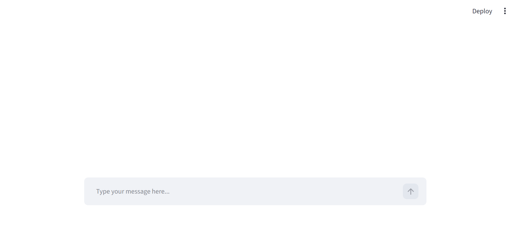
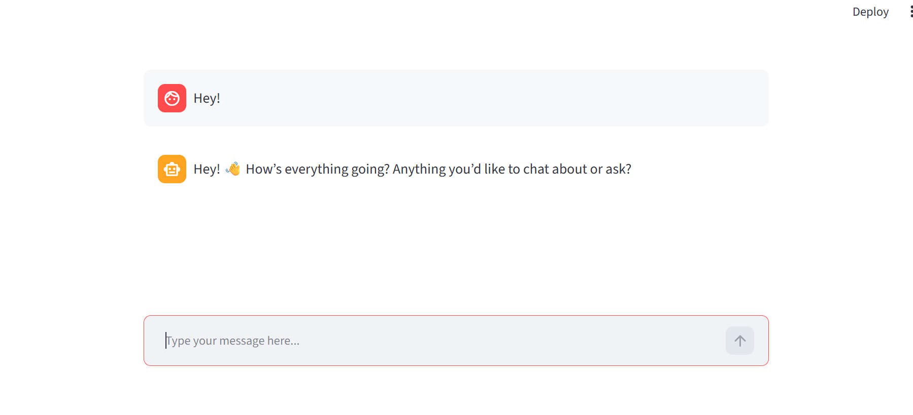
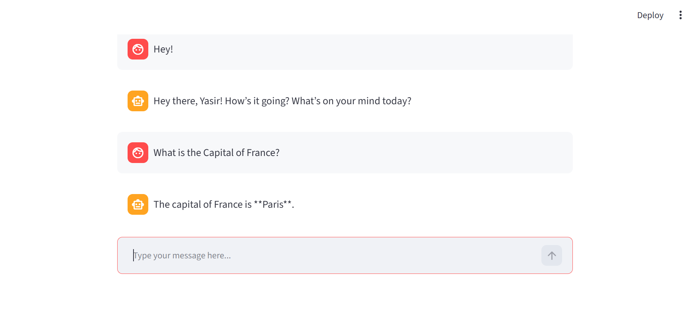

# LangGraph Chatbot

An AI-powered chatbot built using **LangGraph, Groq LLM, and Streamlit**. It supports web search, mathematical calculations, stock price lookup, and persistent conversation history.

## Features

- **AI Chatbot:** Chat with an LLM powered by Groq.
- **Web Search:** Search the web using DuckDuckGo.
- **Calculator:** Perform basic arithmetic operations.
- **Stock Price:** Retrieve stock quotes using Alpha Vantage API.
- **Conversation History:** Access previous conversations.
- **New Chat:** Start a fresh conversation whenever needed.
- **Chat Titles:** Automatically generate titles from the first user message.
- **Persistent Storage:** Save conversation states using SQLite and LangGraph checkpointing.
- **LangSmith Integration:** Support for tracing and monitoring chatbot runs.

## Tech Stack

- Python
- LangGraph
- LangChain
- Groq
- Streamlit
- SQLite
- DuckDuckGo Search (`ddgs`)
- Alpha Vantage API
- LangSmith

## Project Structure

```text
LangGraph-Chatbot/
│
├── langgraph_backend.py
├── streamlit_frontend.py
├── requirements.txt
├── README.md
├── .gitignore
└── Images/
    └── sidebar.png.png
```

## Installation and Setup

### 1. Clone the Repository

```bash
git clone https://github.com/muhammadyasir-Ai/LangGraph-Chatbot.git
```

### 2. Open the Project Folder

```bash
cd LangGraph-Chatbot
```

### 3. Create a Virtual Environment

```bash
python -m venv myenv
```

Activate it on Windows:

```powershell
myenv\Scripts\activate
```

### 4. Install Dependencies

```bash
pip install -r requirements.txt
```

### 5. Configure Environment Variables

Create a `.env` file in the project root directory:

```env
GROQ_API_KEY=your_groq_api_key
ALPHA_VANTAGE_API_KEY=your_alpha_vantage_api_key

LANGSMITH_TRACING=true
LANGSMITH_API_KEY=your_langsmith_api_key
LANGSMITH_PROJECT=LangGraph Chatbot
```

Add your own API keys. Keep `.env` private and never upload it to GitHub.

The Groq API key is required. The Alpha Vantage key is needed for stock price lookup. LangSmith settings are optional.

### 6. Run the Application

```bash
streamlit run streamlit_frontend.py
```

The application will open in your browser.

## How It Works

1. The user sends a message through the Streamlit interface.
2. LangGraph manages the chatbot workflow.
3. The Groq model processes the request.
4. When needed, the chatbot calls the appropriate tool:
   - Web Search
   - Calculator
   - Stock Price
5. LangGraph SQLite checkpointing maintains conversation state.
6. The frontend displays the response and provides conversation history.

## Environment Variables

| Variable | Purpose |
|---|---|
| `GROQ_API_KEY` | Connects to the Groq LLM |
| `ALPHA_VANTAGE_API_KEY` | Retrieves stock prices |
| `LANGSMITH_TRACING` | Enables LangSmith tracing |
| `LANGSMITH_API_KEY` | LangSmith authentication |
| `LANGSMITH_PROJECT` | LangSmith project name |

## Future Improvements

- Improve search result freshness and relevance.
- Enhance response streaming.
- Improve error handling and user experience.

  ## Screenshots

### Chatbot Conversation


### Chatbot Interface


### Chatbot Response


### Sidebar


## Author

**Muhammad Yasir**

- GitHub: [muhammadyasir-Ai](https://github.com/muhammadyasir-Ai)
- LinkedIn: [Muhammad Yasir](https://www.linkedin.com/in/muhammad-yasir-17211a423)

---

If you find this project useful, feel free to explore the repository.
