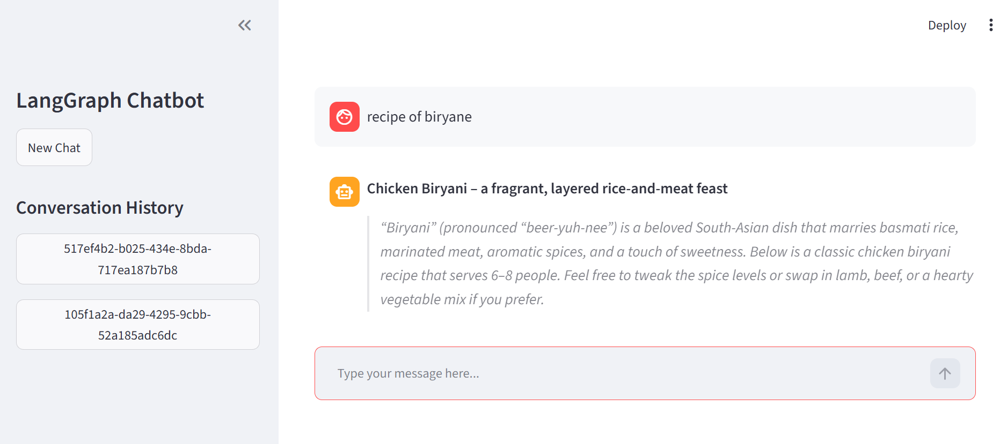

# LangGraph Chatbot

An interactive AI chatbot built using **LangGraph**, **Groq API**, and **Streamlit**.

This project demonstrates how to connect an LLM with a LangGraph backend and build a simple user-friendly chatbot interface using Streamlit.

## Technologies Used

- Python
- LangGraph
- LangChain-Groq
- Groq API
- Streamlit
- Python-dotenv

## Features

- AI-powered chatbot using LangGraph and Groq API
- Interactive chat interface using Streamlit
- Conversation history management
- Streaming responses for real-time AI output

### # New Chat
Starts a new conversation with a unique thread ID.

### # Conversation History
Displays the list of previous chat threads.

### # Load Previous Conversations
Allows users to select and continue previous conversations.

### # Streaming Responses
Displays AI responses in real time instead of waiting for the complete response.

## Project Structure

```text
Langraph_Chatbot/
│
├── langgraph_backend.py
├── streamlit_frontend.py
├── requirements.txt
├── README.md
├── .gitignore
└── .env
```

## Installation and Setup

### 1. Clone the repository

```bash
git clone YOUR_REPOSITORY_URL
```

### 2. Open the project folder

```bash
cd Langraph_Chatbot
```

### 3. Create a virtual environment

```bash
python -m venv myenv
```

### 4. Activate the environment (Windows)

```powershell
.\myenv\Scripts\Activate.ps1
```

### 5. Install dependencies

```bash
pip install -r requirements.txt
```

### 6. Configure API Key

Create a `.env` file in the project folder and add your Groq API key:

```env
GROQ_API_KEY=your_groq_api_key
```

### 7. Run the chatbot

```bash
streamlit run streamlit_frontend.py
```

The chatbot will open in your browser.

## Author

**Muhammad Yasir**

- GitHub: [muhammadyasir-Ai](https://github.com/muhammadyasir-Ai)
- LinkedIn: [Muhammad Yasir](https://www.linkedin.com/in/muhammad-yasir-17211a423)

- ## Screenshots


### Chatbot Conversation
.png)

### Chatbot Interface
.png)

### Chatbot Response
.png)

### Sidebar

### Sidebar


